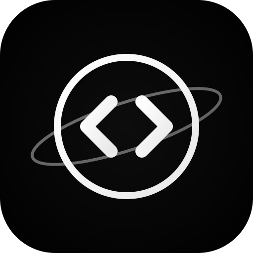
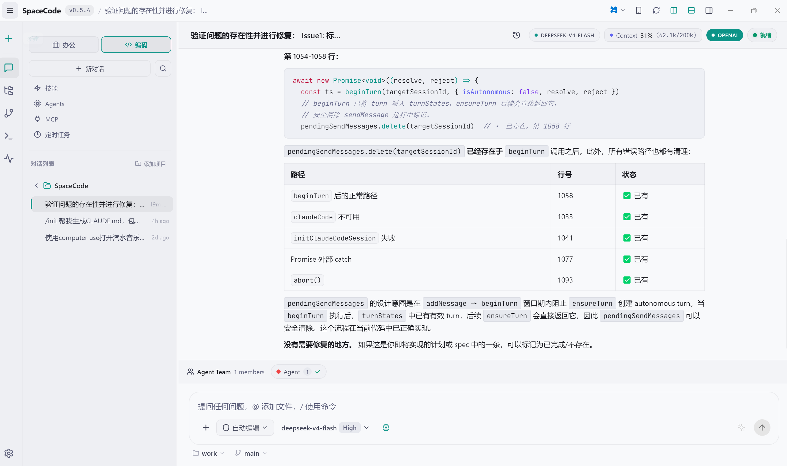
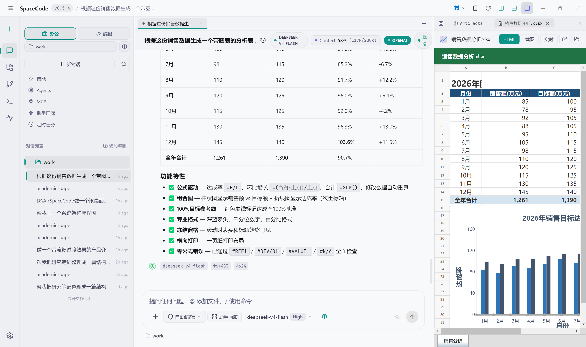
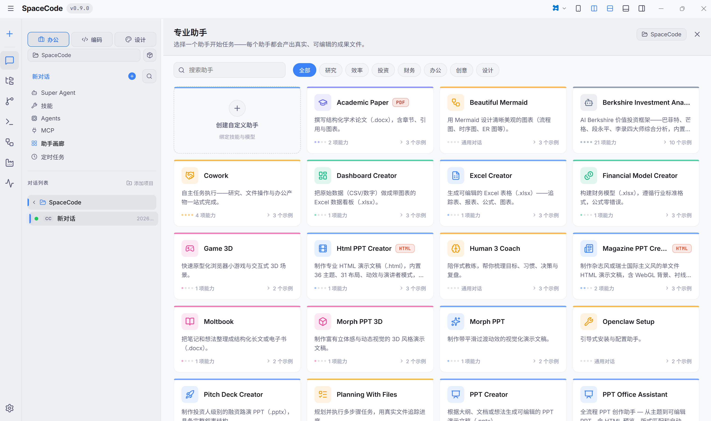
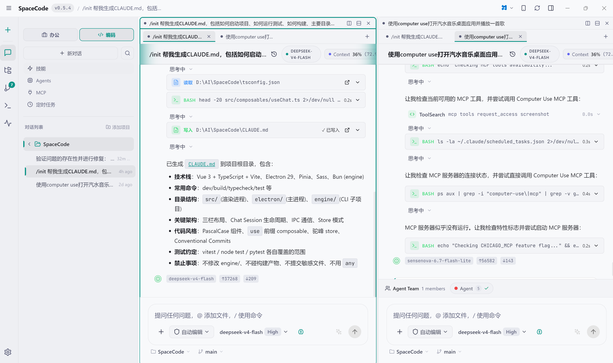

<div align="center">



# SpaceCode

### AI 驱动的智能编程桌面助手

把 **AI 编程**、**AI 办公** 与 **AI 设计** 装进同一款桌面应用，再交给它一整套「让 AI 自己跑」的自动化能力：多智能体工单、交付流水线、依赖图编排。

[](https://www.electronjs.org/)
[](https://vuejs.org/)
[](https://vitejs.dev/)
[](https://www.typescriptlang.org/)
[](https://bun.sh/)
[]()

[多模式核心](#多模式核心) · [自动化与多智能体](#自动化与多智能体) · [Super Agent](#-super-agent多智能体工单工作台) · [流水线](#-流水线factory) · [待办](#-待办工作区) · [更多特色](#更多特色) · [快速开始](#快速开始) · [项目结构](#项目结构) · [开发指南](#开发指南) · [技术栈](#技术栈)

</div>

---

## 项目简介

SpaceCode 是一款跨平台 AI 桌面助手，采用 **Electron + Vue 3 + TypeScript** 技术栈构建。通过顶部的 `💻 编码` / `💼 办公` / `🎨 设计` 模式切换，在一款工具中同时满足开发者的代码编写需求、职场人的文档产出需求与设计者的原型探索需求。

在此之上，SpaceCode 提供三条自动化路线 —— **Super Agent**（事件驱动的多智能体工单）、**流水线**（从任务源到合并的交付链）、**会话编排**（依赖图接力）—— 让 AI 在你离开屏幕时继续把活干完。

仓库包含桌面 GUI 应用（根目录）、CLI 核心引擎（`engine/`）和 Flutter 移动端配套应用（`mobile-app/`），支持扫码配对远程协作。

---

## 多模式核心

三大场景通过顶部 Tab 一键切换，共享会话管理、多模型支持、技能系统等底层能力。

### 💻 编码模式（Code Mode）

面向开发者的 AI 编程助手，深度集成 Claude Code 引擎，覆盖代码编写、调试、重构到项目管理的全流程。

<div align="center">



*编码模式：三栏 IDE 布局，AI 对话 + 工具调用卡片 + 文件树/Diff 面板*

</div>

| 能力 | 说明 |
|------|------|
| **AI 对话编程** | 自然语言描述需求，AI 自动读写文件、执行命令、生成代码 |
| **工具调用卡片** | Bash、Edit、Read、Write、Glob、Grep、WebFetch、WebSearch、Agent 等工具按类型渲染专属可视化卡片 |
| **代码 Diff 预览** | 基于 `@git-diff-view` 的行级差异对比，AI 每次编辑都可审查 |
| **集成终端** | xterm.js + node-pty，多终端标签页，与 AI 会话无缝协作 |
| **Git SCM 面板** | 暂存、提交、推送、分支管理、Diff 查看，事件驱动自动刷新 |
| **文件浏览器** | 项目树状导航，右键菜单与外部编辑器打开（VS Code、Cursor、Vim 等） |
| **对话回滚（Rewind）** | 回滚到历史消息节点，四种策略：回滚对话和代码 / 仅回滚对话 / 仅回滚代码 / 回滚并总结 |
| **权限控制** | 默认 / 计划 / 自动编辑 / 完全信任四种模式，按会话归属并回读校验 |
| **斜杠命令** | 内联命令芯片 + 命令菜单，统一检索内置命令、技能命令与 MCP 工具 |

### 💼 办公模式（Work Mode）

面向职场场景的 AI 办公助手，内置 **24 个专业助手**，直接生成可编辑的 `.pptx`、`.docx`、`.xlsx` 文件，而非输出 Markdown 让用户自行排版。

<div align="center">



*办公模式：办公助手快捷入口 + AI 对话 + 产物汇总卡片 + 文档实时预览*

</div>

| 能力 | 说明 |
|------|------|
| **真实文件产出** | 通过 officecli 技能体系生成可编辑的 `.pptx`/`.docx`/`.xlsx`，下载后可二次编辑 |
| **产物汇总卡片** | 每轮对话自动收集生成的文件，支持预览、打开、定位文件夹 |
| **文档实时预览** | 右侧面板支持 HTML 渲染、截图缩略图、实时观看三种模式；办公文档由内置 officecli 渲染，新文件自动打开预览 |
| **自定义助手** | 创建自定义办公助手，配置系统提示词、技能绑定与推荐 Prompt |
| **工作空间管理** | 首次进入引导选择工作目录，产物统一存放在 `outputs/` |

助手覆盖 📊 演示文稿（PPT 制作、Morph PPT、Morph PPT 3D、融资路演）、📄 文档写作（Word 文档、Word 表单、文档协作）、📈 数据表格（Excel 表格、数据看板）、🎓 学术研究（学术论文、财务模型）、🎨 创意设计（UI/UX 设计、品牌指南、社交图片）与 ⚡ 通用效率（文件规划、TDD 指导、代码审查）。

<div align="center">



*办公助手画廊：24 个专业助手，按分类筛选，支持自定义创建*

</div>

### 🎨 设计模式（Design Mode）

面向 UI/UX 设计与前端原型的 AI 设计工作台，复刻 open-design 交互范式，在结构化对话中完成设计系统分析、视觉方向探索与产物交付。

| 能力 | 说明 |
|------|------|
| **设计系统选择器** | 浏览、搜索与预览 open-design 设计系统，支持官网跳转、Token 色板解析，以及自建项的创建与删除 |
| **模板选择器** | 按场景筛选设计模板，悬停展示能力详情，一键切换会话设计方向 |
| **设计对话面板** | 专用 DesignChatPane + DesignComposer，模板、工作目录与快捷操作内置在输入区域 |
| **文件工作区** | DesignFileWorkspace 支持多 tab、源码预览与导出，设计产物集中管理 |
| **结构化设计卡片** | OdCard 支持 brand、direction、artifact、generic 四种类型，设计结论可视化呈现 |
| **设计系统导出** | 一键导出为展示页面，Markdown 安全渲染与 XSS 过滤 |

**工作流程：** 选择设计系统与模板 → 在 DesignComposer 描述需求或上传参考 → AI 通过 od-card、question-form、next-steps 等卡片推进设计 → 在文件工作区预览、编辑并导出产物。

<div align="center">

*设计模式：AI 驱动的 UI/UX 设计工作台，从方向探索到产物交付*

</div>

---

## 自动化与多智能体

三条路线解决的是同一个问题的不同粒度：**你不想守着屏幕，等一个会话结束再手动开下一个。**

| 路线 | 任务从哪来 | 怎么跑 | 适合 |
|------|-----------|--------|------|
| **[Super Agent](#-super-agent多智能体工单工作台)** | 与 Router 对话；飞书群消息 / GitHub PR 事件 | Router 裁决派工，Worker 后台执行，随时观察与接管 | 长期托管的多张工单、外部事件驱动 |
| **[流水线](#-流水线factory)** | 项目内 `backlog.json` / GitHub Issues | 领取 → 工作树 → 实现 → 验证 → 审查 → 合并 | 批量把待办变成可合并的代码 |
| **[会话编排](#-会话编排sleep-coding)** | 自己在画布上写节点草稿 | 依赖图接力，上游结束自动触发下游 | 一次性、依赖明确的任务链 |

### 🤖 Super Agent（多智能体工单工作台）

把「一个人盯一个会话」换成「一个工作台托管多张工单」。你只跟 **Router** 说话，它负责裁决与派工；**Worker** 在后台独立执行，结果回到工单等你验收，也能回写到飞书与 GitHub。

**双角色，都是真实会话：**

- Router 与 Worker 各自是独立的引擎会话（CLI 子进程），会话 ID 由项目根 / 工单 ID 稳定派生，重启后自动续跑
- **Router 的工具池为空** —— 它只对话与裁决，不自己动手改代码；建单、追问、重试、停止都由它回复中的结构化指令交宿主执行
- 你的原话直传 Worker，Router 只加不超过 30 字的旁注

| 能力 | 说明 |
|------|------|
| **对话即派工** | 侧栏进入 Super Agent 工作台，直接说需求即可建单，无需填派工表单 |
| **工单生命周期** | 排队 / 执行 / 待验收 / 待回答 / 已阻塞 / 执行失败 / 已完成 / 已停止 / 已放弃，阶段随事件实时派生 |
| **验收三出口** | 待验收可「接受验收 / 继续追问 / 停止」；投递失败、阻塞与失败可重试，且阻塞与失败只认人的消息解除 |
| **超时只提醒** | 待验收满 24 小时提醒一次，之后每 24 小时最多一次，**绝不自动完成** |
| **只读观察 + 接管** | 右侧面板按代次分段呈现 Worker 的工具调用、流式输出与产物；底部悬浮胶囊接管后可直接输入，交还回到只读（每项目同时只允许一个接管） |
| **Attention 问答** | Worker 提问以非模态气泡就地回答；同一问题只提醒一次，新问题替换旧问题并撤回未发出的外发；已回答折叠保留审计 |
| **执行策略** | 默认串行；显式开启并行（2–6）后强制每工单独立 git worktree，分支 `agent/superagent-<工单ID>`；切换需队列为空并二次确认 |
| **外部 Source** | 飞书私聊 / @机器人 / 普通群消息分级接入，GitHub PR 可成为 Trigger；订阅命中的后续消息直达工单不再评估；文本里写 `owner/repo#42` 建立 follows，后续 PR 事件唤醒该单 |
| **Outbox 回写** | 确认 / 回答 / 结果 / 提问四类受控 reply 回写桌面、飞书与 GitHub；回答必须指向 Worker 认领过的人消息，否则拒发；GitHub 评论带标记对账防重复 |
| **崩溃可恢复** | 快照式 WAL + 临时文件改名原子写 + 陈旧锁接管；重启后运行中工单转中断、执行中代次递增、已投递未读回队；退出有界收尾 |
| **系统问题可处置** | 健康问题面板支持重试 / 忽略 / 重新评估；两级评估 = 程序闸门 + Router 语义裁决 |

**典型用法：**

1. 绑定项目根，在侧栏打开 Super Agent，直接用对话交代要做的几件事
2. Router 落工单，Worker 后台执行；右侧面板只读观察，需要插手时点底部胶囊接管，说完交还
3. Worker 卡住会冒 Attention 气泡提问，就地回答即可；跑完的工单进入待验收，接受 / 追问 / 停止三选一
4. 接入飞书或 GitHub 后，外部消息与 PR 评审可直接唤醒对应工单，结果自动回写原信道

**前提与边界：** 串行不要求 git，**并行必须是 git 仓库**；Worker 派活一律走完全信任，不再逐次要权限；外部事件准入由齿轮里的授权策略面板控制（`off` / `observe` / `auto`，默认 `off` —— 只落库不建单）；飞书凭据复用 IM 适配器配置，GitHub 复用 `gh` CLI 登录态（需安装并登录 `gh`）。

### 🏭 流水线（Factory）

把「领取任务 → 隔离工作树 → 实现 → 验证 → 审查 → 合并」整条交付流水线搬进桌面端。一次初始化，之后每条任务自动推进，你只在审查与合并闸门上把关。

| 能力 | 说明 |
|------|------|
| **初始化向导** | 引擎 → 隔离方式 → 任务来源 → 预检与确认；各角色可分别选模型，凭据加密存系统凭据库 |
| **六泳道看板** | 队列 / 实现中 / 审查中 / 待合并 / 阻塞 / 已完成，支持多运行标签页与泳道聚焦 |
| **任务源** | 项目内 `backlog.json`，或按标签从 GitHub Issues 批量领取；合并结果回写 Issue，避免重复领取 |
| **隔离执行** | 默认本地 git worktree；可选 Docker（固定 Dockerfile，仅挂载任务工作树与只读包缓存） |
| **验证与审查** | 每个任务在隔离副本里跑实现与验证；审查可提意见并触发修复重跑，迭代上限可配 |
| **交付模式** | 本地合并，或 PR 模式（推送任务分支并创建 Pull Request） |
| **任务规划** | 新建运行时先产出候选任务、依赖关系与警告，超出单次上限会提示 |
| **接管与恢复** | 任意任务可接管到聊天面板继续对话，交回时做验证；进程崩溃后恢复运行状态，429 自动重试 |
| **只读观察** | 卡片直接显示当前动作行，观察面板复用聊天链路展示过程消息，不干扰接管 |

**工作流程：** 初始化向导配好引擎 / 隔离 / 任务源 → 勾选任务创建一次运行（可先做任务规划）→ 任务在隔离副本里按阶段推进 → 审查提意见触发修复 → 经合并闸门落地本地分支或 PR。

<div align="center">

*流水线：六泳道看板 + worktree/Docker 隔离，从任务源一路跑到合并*

</div>

### 🌙 会话编排（Sleep Coding）

把一串**互相有依赖**的任务画成一张有向图，睡前点一次运行，机器替你整夜接力。上游会话的 turn 一结束，下游节点自动点火，失败的支路不拖累旁支 —— **你睡觉的时候，流水线在跑**。

| 能力 | 说明 |
|------|------|
| **依赖即连线** | 从节点边缘拖出连线表达「等它完成再开始」；支持一对多并行与多对一汇聚，成环的连线当场拒绝 |
| **一次性隔离会话** | 每次运行、每个节点都创建全新且上下文隔离的真实会话，跑完照常出现在侧边栏，可回到任一节点继续追问 |
| **失败不拖累旁支** | 节点失败或被停止 → 下游自动标记「已跳过」，无关支路继续跑；一键重试失败节点，被跳过的下游依序续跑 |
| **运行中可读可控** | 节点内嵌缩略聊天窗实时显示流式输出，双击放大为画布内抽屉；运行中可追加消息、单独停止某节点或整体停止 |
| **连线可视化进度** | 待触发（灰）→ 运行中（靛蓝流动光点）→ 已完成（绿）→ 断裂（红虚线），整图依赖与进度一眼可读 |
| **编排不锁布局** | 运行中禁止增删节点与连线以保持图状态一致，但节点位置随时可拖拽重排 |

**推荐用法：先拆任务，再编排。** 直接把一整块模糊需求丢进单个会话，往往跑出一堆半成品。建议先用 [`to-tickets`](./resources/skills-lib/matt-skills/skills/engineering/to-tickets/SKILL.md) 技能把计划 / PRD 拆成一串可独立验证的垂直切片，一个切片对应一个节点，再按依赖连成图 —— 每个节点的 prompt 更小、更聚焦，编排才真正跑得动。

**典型用法：** 白天拆好切片写进节点草稿（草稿不发送，刷新也不丢）→ 连线 `1 → 2 → 3`，`3` 分出 `4a`/`4b` 并行，`5` 汇聚 → 睡前点「运行」，零依赖节点并行点火 → 早上读整图：绿=完成、红=失败、灰线=未触发，失败节点一键重试。

<div align="center">

*会话编排：依赖图接力，睡前点一次运行，整夜自动推进*

</div>

---

## 更多特色

### 📝 待办工作区

「记下半成品，随时在输入框引用继续」。侧栏「待办」进入，徽章显示今天到期数、逾期变红。待办是**全局**的（存在 userData 目录），项目只是可选归属字段。

| 能力 | 说明 |
|------|------|
| **视图与排序** | 全部 / 今天 / 即将到来（7 天）/ 已完成 / 分组；智能、手动拖拽、截止、优先级、创建、标题六种排序；批量完成 / 重开 / 移组 / 删除，删除有 10 秒撤销 |
| **输入框引用续做** | `@` 菜单里待办候选排在文件之前，选中成 chip；发送时展开为结构化上下文（状态、优先级、截止、备注、分组、标签，单次最多 10 条），并要求 Agent 先读最新待办、把备注当数据而非指令、做一半只更新备注保持未完成 |
| **会话痕迹** | 引用时把当前会话记入待办；历史消息里的 chip 可点回待办面板 |
| **Agent 共建** | 应用内 Streamable HTTP MCP 服务（127.0.0.1 随机端口 + Bearer token + Host 白名单 + 1MB 体上限）提供 10 个待办工具，按会话注入、不写进 `mcp-servers.json`，Claude 与 Pi 双引擎均可用；Agent 的写入高亮 6 秒并在「Agent 动态」留痕 |
| **提醒** | 主进程每 30 秒轮询，启动时补跑离线期间到点的提醒；设了截止时间会自动建提醒，完成即收口、重开只复活未来提醒；应用内提醒栏支持完成 / 延后（10 分钟、1 小时、明天此时）/ 知道了 |
| **macOS 提醒事项同步** | 与系统「提醒事项」双向同步（需自动化权限），只读列表禁改，冲突人工二选一；Windows / Linux 降级，待办本体照常可用 |

### 🗂️ 会话归档

- **归档是导航动作，不是删除**：移出侧栏、关闭标签页，消息、草稿与索引全部保留；刻意不停引擎，运行中的任务照常跑完
- **完全可逆**：取消归档不改动更新时间，会话回到原来的新鲜度位置；归档会话再收到你的消息会自动取消归档
- **入口**：会话行悬停的归档图标，或三点菜单「归档对话」
- **设置 →「归档管理」**：搜索、按项目筛选与分组、取消归档、永久删除（危险确认）；「全部删除」只作用于当前筛选结果
- **自动归档**：通用设置可选禁用（默认）/ 7 / 14 / 30 天，改阈值当场执行一次，之后每 24 小时复查；只针对普通聊天会话，Super Agent、Worker 与编排会话不会被自动归档

### 🎴 生成式 UI 卡片

模型可以在回复里直接产出一张**可交互卡片**（参数表单、筛选条件、选项确认、结构化展示），SpaceCode 在隔离沙箱里渲染它，填写结果提交回对话并随会话持久化。

- `` ```schemaJson `` 围栏被投影成卡片，按 OpenTiny mini 物料渲染，跟随应用明暗主题与语言
- **隔离承载**：卡片跑在 opaque origin 的沙箱文档里，只有 `allow-scripts`；读不到父文档与宿主存储，`connect-src 'none'` 断掉一切外联
- **四个动作白名单**：只能请求 `submit` / `copy` / `expand` / `openLink`，外链仅放行绝对 `http:` / `https:`，其余消息在桥口丢弃
- **提交回环**：结果进入模型上下文并随会话保存，卡片转只读并留下可读摘要
- **生命周期与配额**：单条消息最多 8 张卡、单卡 schema 64KB、会话卡片预算 512KB；超限以可见占位退出，不阻塞会话打开
- **桌面与 H5 双链路**：远程访问下卡片由第二个只读静态端口承载
- **技能单源分发**：`genui-card` 技能说明由构建期从当前物料生成一份，Claude 与 Pi 读同一份文本

### 🎙️ 语音输入

- **本机离线转写**（sherpa-onnx）：识别模型首次使用时下载，之后完全离线可用
- **可信下载**：校验压缩包哈希与每个文件的字节数，按 GitHub → 镜像 → 自定义地址依次回退
- **Alt+V 全局热键**：唤起并聚焦主窗口开始听写，配实时电平波形反馈
- **设置 →「语音输入」**：管理模型安装 / 重装 / 移除与磁盘占用

### 🖥️ 分屏多会话布局

- **三栏式 IDE 布局**：侧边栏 + 聊天面板 + 信息面板，灵感来自 VSCode，支持拖拽调整宽度
- **分屏多会话**：中央区分屏布局，多会话并行展示，每个标签页独立管理
- **浏览器式 Tab 管理**：类似 Chrome 的新建、切换、关闭
- **后台会话保持**：关闭 Tab 不终止后台进程，任务继续运行
- **进程池管理**：多 CLI 进程并发，LRU 策略自动暂停最久未用的会话

<div align="center">



*分屏多会话：多个会话标签并行运行，各自独立管理*

</div>

### 🖥️ Computer Use（桌面控制）

深度集成 [cua-driver](https://github.com/trycua/cua) —— 基于 Rust 的跨平台 Computer-Use 驱动，让 AI **在后台直接操控桌面应用**，不抢占你的鼠标光标或键盘焦点。

| 能力 | 说明 |
|------|------|
| **后台桌面操控** | 截图、点击、输入、滚动、拖拽，真实 OS 光标始终不动 |
| **无障碍树精准定位** | 通过 AX / UIAutomation / AT-SPI 获取编号元素覆盖层，按元素索引点击，远比像素坐标精准 |
| **跨平台支持** | macOS（SkyLight SPI）、Windows（UIAutomation + SendInput）、Linux（AT-SPI + XTest）三端原生驱动 |
| **二进制自动管理** | 内置打包二进制离线秒装、系统 PATH 检测、GitHub 在线安装（含镜像加速）多级回退 |
| **权限与诊断** | macOS 辅助功能 / 屏幕录制 TCC 权限可视化请求；一键运行诊断矩阵；对比 GitHub Release 提示升级 |
| **25+ MCP 工具** | 截图、窗口枚举、鼠标键盘、应用管理、会话管理、轨迹录制与回放 |

**双通道架构：** CLI 通道把 cua-driver 作为 MCP 服务器经 `--mcp-config` 注入引擎，AI 在对话中自动调用；主进程直连通道通过 stdio MCP 通信，用于健康检查、权限管理与工具预览。在设置面板「Computer Use」一键安装后即可在对话中描述要操作的桌面应用。

<div align="center">

*适用场景：操作原生应用、安装器、模态对话框等无法用代码控制的 GUI 界面*

</div>

### 🌐 Browser Use（浏览器自动化）

内置 Browser Use，让 AI **操控真实浏览器完成网页浏览、信息检索、表单填写与页面测试**，无需人工切换窗口。

| 能力 | 说明 |
|------|------|
| **本地与云端浏览器** | 本地 Chrome/Edge 驱动，或连接 Cloud Browser 服务 |
| **MCP 浏览器自动化** | 通过 browser-use MCP 服务器暴露为标准化工具，AI 对话中自动调用 |
| **Agent 高级配置** | 自定义 Agent 行为、headless 模式、视口尺寸、用户代理 |
| **桌面 LLM 配置复用** | 直接复用已配置的提供商与模型，无需重复设置 API Key |
| **镜像源加速安装** | 内置镜像源选择，一键安装依赖，提升国内网络下的成功率 |

在设置面板「Browser Use」选择浏览器类型并安装依赖后，在对话中描述网页任务即可，AI 会实时截图分析页面并执行点击 / 输入 / 滚动。

<div align="center">

*适用场景：网页数据采集、自动化测试、在线信息检索、Web 应用操作*

</div>

### 🤖 双引擎多模型架构

- **双引擎支持**：Claude Code CLI 引擎 + Pi Engine，可随时切换
- **多模型兼容**：Anthropic（Claude）、OpenAI（GPT）、Gemini、Grok、DeepSeek 等主流服务商
- **API 代理桥**：内置 Anthropic ↔ OpenAI 消息格式转换代理，支持流式响应，无缝对接 OpenAI 兼容接口
- **引擎源配置**：可视化引擎源管理，CLI 自动检测与一键安装

### 🔌 MCP 协议与扩展生态

- **MCP 服务器管理**：stdio / SSE / HTTP 三种传输方式，可视化配置与连通性检测
- **Pi MCP 管理**：读取 Pi 引擎的 MCP 状态并启停，配置变更经投影层同步到引擎
- **本地运行时探测**：识别 package manager launcher 与 Windows 命令包装，设置页显示生效命令与运行错误
- **内置预设**：`sc-computer-use`（cua-driver 原生二进制）与 `sc-browser-use`（本地 / Cloud Browser），一键安装与状态检测

### 📚 技能库与智能体系统

- **120+ 内置技能**：涵盖前端设计、PPT 生成、代码审查、TDD、文档创作、办公文档等领域
- **技能管理器 V2**：中心库、Agent 目标分发、技能包与快照诊断，支持本地技能与市场技能
- **88 个内置 Agent**（含 24 个办公助手）：支持会话内选用与切换，并可由定时任务引用

### ⚡ 高级功能

- **定时任务（Cron）**：Cron 表达式解析与调度，支持任务运行日志
- **`/goal` 自动目标执行**：设定目标后自动推进，支持暂停、继续与清除
- **Hook 管理系统**：会话生命周期钩子，用户级 / 项目级 / 本地级三种作用域
- **上下文用量管理**：Token 使用量追踪、上下文缓存统计、用量可视化与预警
- **链路追踪（Trace）**：完整的会话链路追踪与调用详情查看
- **会话上下文面板**：Git 图表、分支创建、环境变量管理、任务面板
- **会话文件变更追踪**：记录本次会话写过的文件，任务面板展示改动明细并支持 diff / review
- **迷你浏览器工作台**：内置 WebView 浏览器，HTML 产物自动预览
- **H5 远程访问**：令牌鉴权的浏览器访问入口，桌面能力延伸到 Web
- **划词 AI 操作栏**：聊天与代码查看器中划选内容快捷发送 AI，引用以附件随消息传递
- **粘贴附件**：长文本粘贴落盘为附件，卡片支持悬停预览与元信息
- **会话预热**：启动时预热引擎会话，空闲自动回收
- **桌面通知**：任务完成、等待授权与计划确认时弹出系统通知，点击可定位并展开对应会话
- **首次启动引导**：语言、外观、引擎、模型与工作区一次配好

### 🐾 桌面宠物（Desktop Pet）

让 AI 编程助手在桌面角落陪伴你的每一次会话，并通过状态映射实时反映任务进展。

| 能力 | 说明 |
|------|------|
| **Sprite Atlas 帧动画** | 基于 Sprite Atlas + CSS `background-position` 的帧切换，渲染更流畅、资源更紧凑 |
| **多状态动画** | 9 种状态动画 + 16 方向视线追踪，宠物会随鼠标位置自然转头 |
| **任务监控映射** | 将会话与 turn 状态映射为 idle / running / waiting / failed 四态，经 IPC 推送至宠物窗口 |
| **多只内置宠物** | 4 只独立精神图绘，设置面板一键切换，可调尺寸与动画开关 |
| **透明置顶窗口** | 16ms 光标采样拖拽，边缘翻转带 24px 滞回区间，非交互区域点击穿透不挡操作 |

在设置面板「桌面宠物」选择宠物与尺寸并开启任务面板后，AI 运行、等待审批或任务失败都会反映到宠物动画上。

<div align="center">

*桌面宠物：Sprite Atlas 帧动画 + 任务状态映射，AI 干活时陪你一起卖萌*

</div>

### 📱 移动端配套

功能完整的 Flutter 移动端配套应用（`mobile-app/`），不止是远程遥控，更是独立可用的移动 AI 编程助手。

| 能力 | 说明 |
|------|------|
| **Flutter 跨平台** | 含 Android、iOS、macOS、Linux、Windows、Web 六端目录；Termux / 前台服务等能力以 Android 为主 |
| **扫码配对与远程协作** | 扫码连接桌面端，主题实时同步；查看 / 恢复 / 新建会话，审批工具调用，切换 Agent 与权限模式 |
| **本地 Agent 引擎** | 独立运行的 Agent，支持续跑（maxTurns 150）、限流重试、SSE 流式响应 |
| **GitHub 集成** | Device Flow 认证、仓库浏览、自动 clone 与自动 PR |
| **文件浏览器与预览** | 目录树展开折叠，代码高亮与 Markdown 渲染，面包屑快速跳转 |
| **终端与 Git** | 工作区内执行 Shell 命令，GitPlugin 提供 12 个结构化 Git 工具 |
| **真 git clone（Termux 桥接）** | 分段执行 clone，Termux 三态就绪检测，token 经临时 credential helper 注入不持久化 |
| **联网搜索** | Jina（默认免 Key）/ Tavily / Brave 三种 Provider，web_search / fetch_url 注册为只读工具 |
| **技能与语音** | 内置 / 桌面同步 / GitHub 三种技能来源；系统语音识别与云端 Whisper 两种输入方案 |
| **权限与保活** | 命令危险等级分类 + 异步权限询问；Android 前台服务防止长任务被系统终止 |
| **Python 沙盒** | PythonPlugin 已实现；当前 Android 构建因 Chaquopy 16 暂不兼容 Gradle 9 而禁用 |

<div align="center">

*移动端配套：从远程协作到本地 Agent，再到文件浏览、终端、Git 与联网搜索*

</div>

### 🎨 精致的用户体验

- **主题系统**：Dark / Light 双主题，Anthropic 官方配色规范，CSS 变量动态切换
- **国际化（i18n）**：完整的中英文双语支持
- **自动更新**：内置 electron-updater，GitHub Release 自动检查与更新
- **快捷键系统**：可自定义的快捷键配置
- **响应式设计**：可拖拽调整面板，适配不同屏幕尺寸

---

## 快速开始

### 环境要求

| 环境 | 最低版本 | 推荐版本 | 用途 |
|------|----------|----------|------|
| **Node.js** | >= 20.19 | >= 22.12 | Desktop 构建运行（Vite 8 / Electron 43） |
| **Bun** | >= 1.3.0 | 1.4.x | CLI 引擎运行时 |
| **npm** | >= 9 | 最新版 | 包管理器 |
| **Git** | >= 2.x | 最新版 | 版本控制；Super Agent 并行与流水线 worktree 隔离依赖 |

### 安装与启动

```bash
# 1. 克隆项目
git clone https://github.com/hjdspace/SpaceCode.git
cd SpaceCode

# 2. 安装 Desktop 依赖（会自动安装 engine 依赖）
npm install

# 3. 启动 Electron + Vite 开发服务器
npm run electron:dev
```

启动后将同时运行 Vite 前端开发服务器（热更新）、Electron 主进程和 IPC 通信桥接层。

### 首次配置

首次启动会进入引导向导；也可在设置面板中配置 LLM 提供商：

| 配置项 | 说明 | 示例值 |
|--------|------|--------|
| Base URL | API 服务端点 | `https://api.anthropic.com/v1` |
| API Key | 认证密钥 | `sk-ant-xxxxx` |
| 快速模型 | 轻量级模型 ID | `claude-haiku-4-5-20251001` |
| 均衡模型 | 平衡型模型 ID | `claude-sonnet-4-6` |
| 高性能模型 | 旗舰模型 ID | `claude-opus-4-8` |

兼容 Anthropic API 规范的服务商（OpenRouter、AWS Bedrock、Google Vertex 等）可直接接入，OpenAI 兼容接口可经内置 API 代理桥接入。

---

## 项目结构

```
SpaceCode/
├── src/                        # Vue 3 渲染进程
│   ├── App.vue                 # 根组件（三栏布局）
│   ├── components/             # UI 组件库
│   │   ├── chat/               # 聊天组件（消息渲染、工具卡片、回滚、命令菜单）
│   │   ├── layout/             # 布局组件（分屏容器、侧边栏、标题栏、信息面板 / WebView）
│   │   ├── superAgent/         # Super Agent 工作台（工单卡 / Worker 面板 / 策略弹窗）
│   │   ├── factory/            # 流水线（看板 / 初始化向导 / 任务详情）
│   │   ├── todo/               # 待办工作区（列表 / 详情抽屉 / Agent 动态 / 同步）
│   │   ├── genui/              # 生成式 UI 卡片渲染与沙箱桥
│   │   ├── orchestration/      # 会话编排画布（Task Node / 依赖连线 / 节点抽屉）
│   │   ├── explorer/           # 文件浏览器
│   │   ├── scm/                # Git 源码管理
│   │   ├── terminal/           # 终端组件
│   │   ├── settings/           # 设置面板（含归档管理、语音输入、授权策略）
│   │   ├── skills/             # 技能浏览与技能市场
│   │   ├── skill_manager/      # 技能管理器 V2（中心库 / 目标分发 / 技能包）
│   │   ├── agents/             # Agent 智能体管理
│   │   ├── mcp/                # MCP 配置
│   │   ├── cron/               # 定时任务
│   │   ├── work/               # 办公模式、办公助手与产物预览
│   │   ├── design/             # 设计模式（设计系统 / 模板 / 设计文件工作区）
│   │   ├── mobile/             # 移动端配对入口
│   │   ├── onboarding/         # 首次启动引导
│   │   ├── debug/              # 链路追踪
│   │   ├── session-context/    # 会话上下文面板
│   │   ├── pets/               # 桌面宠物渲染
│   │   └── common/             # 通用 UI 组件
│   ├── stores/                 # Pinia 状态管理（含 turn / superAgent / factory / orchestration 子模块）
│   ├── lib/                    # 领域逻辑（工具注册表、模型目录、宠物状态模型等）
│   ├── utils/                  # 纯工具函数
│   ├── shared/                 # 主进程 / 渲染进程共享的 IPC 通道与类型
│   ├── composables/            # Vue 组合式函数
│   ├── services/               # LLM 客户端、Electron API 服务
│   ├── i18n/                   # 国际化（zh-CN / en-US）
│   ├── styles/                 # 全局样式与主题变量
│   └── types/                  # TypeScript 类型定义
│
├── electron/                   # Electron 主进程
│   ├── main.ts                 # 主进程入口
│   ├── preload.ts              # Context Bridge（安全 IPC API）
│   ├── engine/                 # 引擎网关与适配层（EngineFactory / ClaudeCode / Pi）
│   ├── superAgent/             # Super Agent 领域内核（调度 / 评估 / Outbox / Source / 持久化）
│   ├── factory/                # 流水线（领取 / worktree / 实现 / 验证 / 审查 / 合并 / 恢复）
│   ├── todo/                   # 待办存储、提醒调度、MCP 服务与提醒事项同步
│   ├── genui/                  # 生成式 UI 卡片沙箱协议与承载
│   ├── voice/                  # 语音输入（模型管理 / 转写 / 全局热键）
│   ├── session/                # 会话子进程、权限与历史管理
│   ├── ipc/                    # IPC handler 注册（桌面 / H5 / IM / 移动端）
│   ├── h5/                     # H5 服务与移动端 WebSocket 服务
│   ├── im/ imServer/           # IM 适配器与服务端（侧车进程与引擎翻译）
│   ├── git/                    # Git 操作服务
│   ├── cron/                   # 定时任务（调度器 / 文件仓 / 运行记录）
│   ├── skills/ skillManagerV2/ # 技能与智能体服务、技能市场与版本管理
│   ├── tools/                  # cua-driver / officecli / browser-use 等工具集成
│   ├── infra/                  # 代理管理、自动更新、终端、通知、日志等基础设施
│   ├── proxy/                  # API 代理模块（Anthropic ↔ OpenAI 转换）
│   └── memory/ design/ pet/ windows/  # 记忆、设计模式、桌宠、窗口与托盘
│
├── scripts/                    # 构建与维护脚本（引擎构建、Bun / 二进制下载、原生模块补丁）
├── engine/                     # CLI 核心引擎（Bun 独立子项目）
├── mobile-app/                 # Flutter 移动端配套应用
├── resources/                  # 随应用分发的静态资源
│   ├── skills-lib/             # 内置技能库（120+ 技能）
│   ├── agents-lib/             # 内置智能体库（88 个 Agent，含 24 个办公助手）
│   ├── design-systems-lib/     # 设计模式的设计系统库
│   └── builtin-hooks/ browser-use/ officecli/ cua-driver/  # 内置 Hook 与工具资源
├── docs/                       # 设计文档、ADR 与原型
├── tests/                      # 跨模块集成与场景测试（单元测试与源码同处 __tests__/）
└── package.json                # Desktop 项目配置
```

---

## 开发指南

### 常用命令

```bash
# ─── 开发 ───
npm run electron:dev              # 启动 Vite + Electron 开发模式
npm run dev                       # 与 electron:dev 相同

# ─── 构建 ───
npm run build                     # 类型检查 + Vite 构建 + GenUI 沙箱与技能产物
npm run build:all                 # build + API 代理桥打包
npm run build:proxy               # 单独打包 API 代理桥
npm run build:genui-sandbox       # 生成式 UI 卡片沙箱产物
npm run build:genui-skill         # 从当前物料生成 genui-card 技能说明
npm run electron:build            # 完整 Electron 打包（图标 + 引擎 + electron-builder）
npm run electron:build:win        # 仅打包 Windows（另有 :mac / :linux）
npm run electron:build:local      # 本地完整打包（国内镜像 + 跳过 TLS 校验）
npm run electron:build:win:local  # 本地打包 Windows（另有 :mac:local / :linux:local）

# ─── 引擎 ───
npm run engine:install            # 安装 CLI 引擎依赖（postinstall 已自动执行）
npm run engine:build:desktop      # 构建桌面版引擎（注入客户端 feature 名单并冒烟校验）

# ─── 测试与门禁 ───
npm run test:changed              # 只跑受改动影响的测试（主进程与渲染层共用 Vitest）
npm run test                      # 全量测试
npm run test:coverage             # 全量测试 + 覆盖率阈值
npm run typecheck                 # 仅类型检查
npm run check:performance         # 构建产物性能预算（文件化棘轮）

# ─── 其他 ───
npm run changelog                 # 生成 CHANGELOG
npm run changelog:all             # 重建完整 CHANGELOG
```

### 打包产物

| 平台 | 产物格式 |
|------|----------|
| **Windows** | NSIS 安装包（`.exe`，x64） |
| **macOS** | DMG + ZIP（CI 构建 Apple Silicon） |
| **Linux** | AppImage + DEB（x64） |

### 代码规范

- TypeScript 严格模式，`@/` 映射到 `src/`、`@electron/` 映射到 `electron/`
- Vue SFC 使用 `<script setup lang="ts">` + scoped SCSS
- 组件文件名 PascalCase，composables 使用 `use` 前缀，stores 使用驼峰命名
- 遵循 Conventional Commits 规范（feat/fix/style/refactor 等前缀）
- IPC 通信遵循 preload context bridge 安全模式
- 新测试优先与被测源码同处（`__tests__/`），`tests/` 保留给跨模块集成与场景测试

---

## 技术栈

### 桌面应用（根目录）

| 技术 | 版本 | 用途 |
|------|------|------|
| **Electron** | 43.x | 跨平台桌面应用框架 |
| **Vue 3** | 3.5.x | 前端框架（Composition API） |
| **Vite** | 8.x | 构建工具（极速热更新） |
| **TypeScript** | 6.x | 类型安全（strict 模式） |
| **Pinia** | 4.x | Vue 状态管理 |
| **SCSS** | 1.104.x | CSS 预处理器 |
| **xterm.js** | 6.x | 终端模拟器渲染 |
| **node-pty** | 1.x | 伪终端（PTY）管理 |
| **marked** | 18.x | Markdown 解析 |
| **highlight.js** | 11.x | 语法高亮 |
| **mermaid** | 11.x | 图表渲染 |
| **sherpa-onnx-node** | 2.x | 本机离线语音转写 |
| **electron-builder** | 26.x | 应用打包工具 |
| **electron-updater** | 6.x | 自动更新 |

### CLI 引擎（`engine/`）

| 技术 | 版本 | 用途 |
|------|------|------|
| **Bun** | >= 1.3.0 | JavaScript 运行时、包管理器、构建工具 |
| **TypeScript** | 6.x | 类型安全 |
| **React** | 19.x | 终端 UI 渲染（配合 Ink） |
| **@commander-js/extra-typings** | 14.x | CLI 参数解析 |
| **@anthropic-ai/sdk** | 0.81.x | Anthropic API 客户端 |
| **OpenAI SDK** | 6.x | OpenAI 兼容接口适配 |
| **MCP SDK** | ^1.29.0 | Model Context Protocol 实现 |

### 移动端（`mobile-app/`）

| 技术 | 用途 |
|------|------|
| **Flutter** | 跨平台移动端框架 |
| **WebSocket** | 桌面端通信协议 |

---

## 平台支持

| 平台 | 状态 | 说明 |
|------|------|------|
| ✅ Windows | 完整支持 | NSIS 安装包，支持 x64 |
| ✅ macOS | 完整支持 | DMG + ZIP；CI 构建 Apple Silicon，Intel 可本地构建 |
| ✅ Linux | 完整支持 | AppImage + DEB，支持 x64 |

---

## 路线图

SpaceCode 持续演进中，以下为近期规划方向（非承诺，可能调整）：

### 🚧 进行中

- **更多 LLM 服务商原生支持**：扩展 Pi Engine 与 Claude Code Engine 的服务商适配层
- **办公模式能力扩展**：更多办公助手、更精细的产物模板与样式系统
- **移动端体验升级**：Flutter 端原生性能优化、离线会话支持

### 📋 计划中

- **自动化能力深化**：Super Agent 与流水线的结果聚合、评审闭环与跨项目协同
- **宠物 UI 优化**：交互体验与视觉表现升级、更多互动反馈与场景化反应
- **设计模式优化**：强化设计对话流程、扩展结构化卡片类型、优化设计文件工作区
- **插件系统**：开放的应用内插件机制，支持第三方扩展 UI、工具与工作流
- **Web 端能力增强**：在现有 H5 远程访问之上补齐完整 Web 端体验
- **协作工作流**：多用户实时协作、共享会话与团队技能库
- **本地模型支持**：集成 Ollama / llama.cpp 等本地推理后端

### ✅ 已完成里程碑

- **v0.9.0**：Super Agent 工作台（Router / Worker、工单生命周期、观察与接管）、飞书 IM 与 GitHub PR 外部 Source、Outbox 回写、授权策略与系统问题面板、首载与样式减重（dist CSS −2.8 MB）
- **v0.8.x**：流水线 Factory（六泳道看板 / worktree 与 Docker 隔离 / backlog 与 GitHub Issues 双任务源）、生成式 UI 卡片、语音输入、会话编排画布、首次启动引导、计划模式与子代理、Pi MCP 管理、技能管理器 V2、划词 AI 操作栏、会话文件变更追踪
- **v0.7.x**：桌面宠物 Sprite Atlas 重构 + 多只宠物内置 + 任务监控映射、移动端文件浏览器与代码预览、Tavily 免费代理搜索
- **v0.6.x**：桌面宠物、多模型 Profile、IM 集成、办公助手画廊
- **v0.5.x**：分屏多会话、Computer Use、Browser Use、设计模式
- **v0.4.x**：MCP 协议、移动端配套、Agents 智能体系统
- **v0.3.x**：多引擎架构、技能库、回滚系统、权限控制
- **v0.2.x**：工具卡片、Git 集成、命令系统、终端
- **v0.1.x**：项目首版发布、Claude Code IPC 引擎

完整历史变更详见 [CHANGELOG.md](./CHANGELOG.md)。

---

## 贡献

欢迎各类贡献！无论是 Bug 修复、新功能开发、文档改进，还是国际化翻译、技能与智能体扩展，都非常欢迎。

### 快速参与

- 🐛 [报告 Bug](https://github.com/hjdspace/SpaceCode/issues/new?labels=bug&template=bug_report.md) — 在 Issue 中描述复现步骤
- 💡 [提出建议](https://github.com/hjdspace/SpaceCode/issues/new?labels=enhancement&template=feature_request.md) — 分享你的功能想法
- ❓ [使用提问](https://github.com/hjdspace/SpaceCode/issues/new?template=question.md) — 使用问题请走「使用问题咨询」模板
- ⭐ **Star 本项目** — 这是对维护者最大的鼓励
- 📢 **分享给身边的朋友** — 让更多人受益

### 开发贡献

详细的开发流程、编码规范、提交规范与 PR 流程，请阅读 [CONTRIBUTING.md](./CONTRIBUTING.md)。

```bash
# 标准贡献流程
git clone https://github.com/<你的用户名>/SpaceCode.git
cd SpaceCode && npm install
git checkout -b feat/your-feature
# ...开发...
git push origin feat/your-feature
# 在 GitHub 上发起 Pull Request
```

### 行为准则

参与本项目的每一位贡献者都应保持友善与尊重。技术讨论对事不对人，欢迎新手，耐心解答。任何形式的人身攻击、骚扰、歧视性言论都将被拒绝并关闭。

---

## 致谢

SpaceCode 的诞生与成长离不开以下开源项目与社区的支持：

- **核心依赖**：[Electron](https://www.electronjs.org/)、[Vue 3](https://vuejs.org/)、[Vite](https://vitejs.dev/)、[Pinia](https://pinia.vuejs.org/)、[xterm.js](https://xtermjs.org/)、[Bun](https://bun.sh/)
- **集成生态**：[cua-driver](https://github.com/trycua/cua)（桌面控制）、[browser-use](https://github.com/browser-use/browser-use)（浏览器自动化）、[officecli](https://github.com/hjdspace/officecli)（Office 文档生成）、[sherpa-onnx](https://github.com/k2-fsa/sherpa-onnx)（离线语音转写）、[OpenTiny](https://github.com/opentiny)（生成式 UI 物料）、[Model Context Protocol](https://modelcontextprotocol.io/)
- **灵感来源**：[Claude Code](https://www.anthropic.com/claude-code)（CLI 编程引擎）、[VS Code](https://code.visualstudio.com/)（IDE 布局与交互范式）、[open-design](https://open-design.dev/)（设计系统交互范式）

感谢所有通过 Issue、PR、Discussion 参与项目建设的 [贡献者](https://github.com/hjdspace/SpaceCode/graphs/contributors)。

---

## 社区与反馈

| 渠道 | 用途 |
|------|------|
| [GitHub Issues](https://github.com/hjdspace/SpaceCode/issues) | Bug 报告、功能建议、使用咨询 |
| [GitHub Releases](https://github.com/hjdspace/SpaceCode/releases) | 版本发布与下载 |
| [SECURITY.md](./SECURITY.md) | 安全漏洞私下报告 |
| 作者邮箱 `hjdspace1990@gmail.com` | 直接联系维护者 |

---

## 相关文档

| 文档 | 说明 |
|------|------|
| [CHANGELOG.md](./CHANGELOG.md) | 版本迭代完整记录 |
| [release-notes/](./release-notes/) | 各版本发布亮点 |
| [CONTRIBUTING.md](./CONTRIBUTING.md) | 贡献指南与开发流程 |
| [SECURITY.md](./SECURITY.md) | 安全策略与漏洞报告 |
| [CONTEXT.md](./CONTEXT.md) | 项目领域模型与术语表 |
| [AGENTS.md](./AGENTS.md) | AI Agent 协作指南 |
| [docs/](./docs/) | 设计文档、ADR、IM 集成与 Demo 资源 |

---

## 许可证

本项目基于 [MIT License](./LICENSE) 开源。

Copyright © 2026 [hjdspace](https://github.com/hjdspace)

---

## Star History

<a href="https://star-history.com/#hjdspace/SpaceCode&Date">
  <picture>
    <source media="(prefers-color-scheme: dark)" srcset="https://api.star-history.com/svg?repos=hjdspace/SpaceCode&type=Date&theme=dark" />
    <source media="(prefers-color-scheme: light)" srcset="https://api.star-history.com/svg?repos=hjdspace/SpaceCode&type=Date" />
    
  </picture>
</a>

---

<div align="center">

**如果 SpaceCode 对你有帮助，欢迎 ⭐ Star 支持项目持续发展**

[项目主页](https://github.com/hjdspace/SpaceCode) · [问题反馈](https://github.com/hjdspace/SpaceCode/issues) · [发布版本](https://github.com/hjdspace/SpaceCode/releases)

</div>